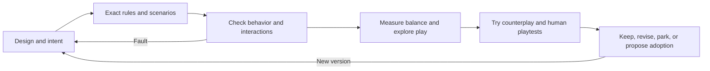

# King Down designer test framework

Status: approved for saved studies, interaction tests and measurement links.

Owner approval, 2026-10-12: “approved. start building the framework on this
branch, beginning with saved studies and interaction tests.” Tickets 02 and 03
are the current build scope. The owner approves the rendered study layout on
2026-10-13: “Approve the layout”. On 2026-10-14 the owner approves the next stage:
“connect saved studies and interaction tests to the existing balance measurements
and results.” The saved-study browser, command line, measurement plans and
evidence links are built. See the [usage guide](usage.md) for controls and limits.

King Down is a game that designers can extend. A designer must be able to make a
rule, see what it does, try it with other rules, find ways to use and oppose it,
and decide whether it makes good play. Balance is one part of this process.

**Use the Proving Ground as the design and play surface. Use the game engine as
the source of behavior. Use the balance system as the evidence store. Connect
them with exact versions, saved scenarios and repeatable studies.**

The framework gives each design six separate answers: correctness, fit with other
rules, balance, strategy, counterplay and human experience. It does not reduce
them to one score. A rule can be fair on average and still make dull play. A strong
combination can make good play if both players can see it and respond.

## Use the framework

Start with the [study template](study-template.md). Use the
[test protocol](test-protocol.md) to choose checks. The
[worked studies](worked-studies.md) show how this applies across design types.
The [source review](source-review.md) records what the three chats built, what is
on main, and what still needs work.

The documents support a manual study. The first software layers save positions,
check interactions, prepare population measurements and show related evidence.
The full workflow below remains the design target. A study cannot pass a stage whose tool support is
missing. It can still save its idea and list the missing check.

## The designer workflow

1. **Start from a working item.** Copy a piece, card, power, effect or game rule.
   State the intended choice: what should players be able to do now? State the
   cost and the expected answer from the opponent. A new design has no evidence.
2. **Change one thing.** Paint movement on the board or edit a short rule sentence.
   Keep the approved three-rule limit for a piece. Show timing and exceptions in
   words beside their board marks. Editing an official item creates a private copy.
3. **Try exact situations.** Show a normal case, a blocked case and a boundary
   case. Let the designer inspect, act, undo, switch sides and save the position.
   Inspection does not play a move. The same action must mean the same thing here,
   in a full game, and in a simulation.
4. **Add company.** Select another item or ask for likely interactions. Show what
   changes on the same board. Save good combinations, surprising outcomes and
   failures as scenarios. Separate “not supported” from “illegal in this position”.
5. **Test a question.** Select a study recipe, its baseline and its intended scope.
   Show a short plan: what differs, what stays fixed, what it can answer, and the
   expected cost. A deterministic check needs no game campaign. A campaign needs
   the owner's run go under the existing project rules.
6. **Explore play.** Collect plans and the opponent's replies, not only winning
   moves. Try both sides from before a threat forms. Save a challenge from an
   interesting position and let a person try it without the suggested answer.
7. **Decide.** Read the six answers and the open gaps. Keep in the lab, revise,
   park, or propose adoption for a named game mode. Only the owner adopts rules.

The first view stays one item and one board. “Try with”, “Test” and “Results” add
detail on request. Reuse the game's figures, green move tiles, red targets, shot
marks, paths and Why tag. Do not introduce a second board legend or a report
dashboard as the default editor.

## One behavior model and linked records

These are logical records, not six new services or a new rule language. Keep them
as versioned data beside the existing modules. Reuse existing types where they
already express the meaning.

| Record | Required content | Purpose |
|---|---|---|
| Design version | Stable ID, parent version, kind, intent, rule parts, parameters, limits, source and approval | Identifies exactly what the designer changes |
| Ruleset | Exact design versions, fully resolved game rules, army and card pools, deal and setup constraints | Defines the complete game, including defaults |
| Scenario | Ruleset, full starting state, history or legal prefix, actions, expected facts, origin | Reproduces one situation or challenge |
| Study | Question, controls, population, policies, measures, limits, seed schedule, stopping and confirmation plan | Defines a comparison before it runs |
| Observation | State and action trace, stable entity IDs, result, source, validity and raw-file reference | Records what actually happens |
| Evidence and decision | Claim, scope, estimate or finding, uncertainty, limits, linked observations, reviewer and owner decision | Connects an answer to its proof |

An edit creates a new design version. Old evidence stays with the old version.
The library can show it as related evidence, but cannot count it as a current pass.
An incompatible saved format is refused with a clear reason. Do not silently
drop rules or apply part of a ruleset to a saved game.

### Meaning by design type

Start from [MATRIX](../../MATRIX.md), including C.1 and D.1–D.5. A new candidate
gets a matrix entry marked as a lab proposal before its implementation. This
framework adds no game item and changes no official rule.

| Type | The definition must state | Extra checks |
|---|---|---|
| Piece | Move, capture and attack patterns; blockers; conditions; protection; transformation; initial state | Pins, checks, shots, chains, promotion, reserve entry, value and participation |
| King power | Owning king; passive or spent; uses; targets; action cost; duration; conditions | Both kings, checks, spent state, turn timing; it cannot change other pieces' movement |
| Card | Effect; copies and deal frequency; target; cost; use and copy rules; history; timing | Drawn versus played, opportunity to use, copied cards, hidden information if the mode has it |
| Effect | Source and target identity; trigger or active condition; state change; expiry; stacking and replacement | Repeated triggers, source removal, ownership change, identity after a swap or promotion |
| Game rule | Setup, turn, zone, capture, resource or end rule; scope; exceptions | Invariants it changes, compatibility with each affected item, all terminal outcomes |
| Scenario or challenge | Full state and rules; how the state is reached; task; success, failure and end conditions | Reachability, alternative solutions, difficulty with people, and replay |

An effect is a shared behavior part. A card and a power can use the same part with
different costs or targets. That does not make their balance evidence interchangeable.
Distinguish “while this holds” from “after this event”. Distinguish a move, an attack,
a capture, a shot, relocation, a swap and selection of a target.

### Timing is part of the rule

Every effect states when it checks its condition, when it chooses targets, when it
pays a cost, which sub-actions follow, when it checks king safety, and when it
expires. “Next turn” names the side and the boundary. An extra action is not
automatically a new turn. Use the actual side and turn state; never infer them
from an action's index.

Preserve the engine's existing order. Do not impose one universal order on all
cards and powers. For a new composition, declare the applicable order and how a
conflict resolves. Refuse an unresolved conflict. Check required intermediate
states as well as the final state. Final king safety alone is not a sufficient
contract for every multi-step action.

Each repeated effect needs a termination rule: a spent use, a decreasing resource,
or a proven finite event chain. A defensive event limit reports a fault. It must
not silently cut off an effect and call the result a normal game.

## Support and evidence are separate

Show support for each operation: edit, board preview, full game, computer play,
replay and measurement. Each cell is supported, unsupported with a reason, or
not checked. A feature can work on a Try board but lack the history needed for a
full game. A legal computer move does not prove that the computer understands it.

Show evidence in separate rows:

| Answer | Evidence needed | What it does not prove |
|---|---|---|
| Works as defined | Positive, negative and boundary fixtures; state round trips; direct legal replay | Fairness or good play |
| Fits other rules | Risk-based pair and multi-rule fixtures; full ruleset checks; valid state after each action | That every possible combination is safe |
| Has suitable strength and use | Controlled worth, activity, outcome and interaction studies with intervals | Skill of people or enjoyment |
| Enables strategies | Repeatable plans, actual behavior changes, cross-play and fresh examples | A named plan is best or unavoidable |
| Allows counterplay | Replies found before and after threats; sufficient search; human attempts | A universal answer from a finite search |
| Makes good play | Observed choices, understanding, effort, surprise, frustration and repeat-play preference | A population claim from a small playtest |

Evidence can be valid, invalid, missing, inconclusive, or stale for the current
version. A band check can pass or fail only when valid evidence resolves its
limit. A summary may say “ready for playtest” while balance stays inconclusive.
Approval remains a separate owner decision with a date, scope and reason.

## Build on the current code

| Responsibility | Current seam | Proposed extension |
|---|---|---|
| Author pieces | `src/workshop/model.ts`; `src/rules/design.ts` | Retain `DesignSpec` and its rule parts; add stable design and rule-instance references |
| Execute actions | `src/rules/engine.ts`; `src/rules/rules.ts` | Test existing named card/power behavior first; add shared effect data only for a demonstrated need |
| Explain the board | `src/workshop/why.ts`, `scene.ts`; `src/render/legend.ts` | Keep rule influence traces; add engine reasons and events where legality or timing needs them |
| Save and replay | `Position`; FEN/LAN in `src/rules/setup.ts`; `src/sim/replay.ts` | Save complete scenario state and history; check every replayed action against legal moves |
| Run studies | `RunSpec`, `buildJobs`, `playGame`, `checkResume` in `src/sim/` | Pin complete policy settings; reuse campaign and combination work after review and integration |
| Read evidence | `src/balance/` and `tools/piece-activity.ts` | Link observations to design versions, scenarios and claims; add ability-level event measures |

Current main supports one custom design in the `T` slot. It has full games and
simulation support. It refuses the custom-piece history conditions `fromMove`,
`beforeMove` and `afterCard`. The Try board can model more than a full game can.
Multiple distinct custom designs in one game need a separate engine change.
Do not claim that a second design works by assigning it the same `T` slot.

The current Why trace measures the influence of removing rule parts. It does not
record execution order or every legal-move refusal. Keep that distinction visible.
The current balance `effects.ts` predicts statistical effects; it does not execute
game effects. The general effect model belongs with the rules.

Run each test ruleset in an isolated worker or process. The current `withRules`
adapter changes global rules and restores them synchronously. Do not share it
across concurrent or asynchronous studies. Search tables and evaluator state also
need the full ruleset and policy identity or a reset between cases.

## Delivery in complete steps

| Step | Designer can do this at the end | Acceptance |
|---|---|---|
| [02 Save a design study](issues/02-save-a-study.md) | Copy one supported piece, save an exact scenario, play, undo and replay it, compare with its parent | Same behavior in board, game and sim; unsupported operations give reasons |
| [03 Check interactions](issues/03-check-interactions.md) | Test an existing card, power or rule with that design; save a regression or challenge | Stable traces, direct legal replays, coverage gaps and risk-based multi-rule checks |
| [04 Connect measurements](issues/04-connect-measurements.md) | Prepare and inspect a repeatable balance or strategy study | Complete context, valid controls, correct uncertainty, no automatic launch or adoption |
| [05 Extend authoring and playtests](issues/05-author-and-playtest.md) | Define a new supported effect/card/power, collect human play evidence and submit a decision packet | Each added behavior works end to end; clarity and play tests recorded; unsupported compositions refused |

Build each step against this base and review it independently. Reconcile the
existing branch tools before reuse; do not copy their older game engine over main.
Each visual step needs an approved rendered sample under the project rules.
Multiple custom types and unrestricted rule scripting are outside the first build.
Later engine extensions use the same contracts and tests.

## Proposed first study and decisions

Start with a supported custom copy, then the existing Mimic + SkyLift case. The
first checks that one design travels through the system unchanged. The second
tests whether the system can explain an observed strategy failure without calling
it a card-balance failure. See the [worked studies](worked-studies.md).

The owner can approve steps 02–03 as the first software build. This adopts no new
game rule and authorizes no simulation campaign. Keep the current piece criteria,
show criterion 4b separately, and set practical effect margins for each later
study before its run. No universal fun score or automatic rebalance is proposed.
